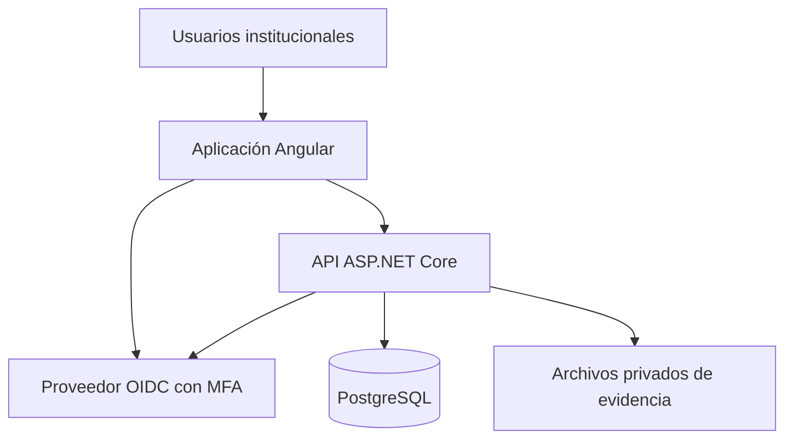

# Plan de construcción de SISPLAN

12 de noviembre de 2026 · Reto Web PEI–POA · Equipo de cinco

El grupo eligió **Angular para el frontend**. La primera entrega interna será un recorrido con datos persistidos: formular un PEI, generar su POA, programar una actividad, guardar su avance con evidencia, evaluar y consultar el resultado. Sobre ese recorrido se incorporarán los módulos y casos restantes del SRS.

## Documentos de trabajo

| Documento | Para qué se usa |
|---|---|
| [Primer incremento](06-PRIMER-INCREMENTO.md) | Ejecutar y verificar la captura y edición de borradores PEI |
| [Flujos y estados](02-FLUJOS.md) | Acordar qué hace cada rol, qué caminos existen y cuándo cambia un estado |
| [Datos, API y pruebas](03-DATOS-API-QA.md) | Dividir el trabajo entre Angular y la API y comprobar la integración |
| [Frontend Angular](04-FRONTEND-ANGULAR.md) | Construir rutas, pantallas, formularios y componentes coherentes |
| [Matriz de trazabilidad](05-TRAZABILIDAD.md) | Comprobar cada RF, RN y RNF contra su fuente, tarea y criterio de aceptación |

## Alcance de la entrega

- **Planificación estratégica.** PEI de 4 o 5 años, ejes, objetivos, resultados, indicadores, líneas de acción, metas plurianuales y mapa estratégico.
- **Planificación operativa.** Un POA por año del PEI, productos vinculados con la estrategia, actividades, responsables, metas, cronograma y presupuesto.
- **Seguimiento y evaluación.** Avances físicos y financieros, comentarios, evidencias con versiones, tres evaluaciones por POA, cálculo, semáforo y correctivos.
- **Consulta y control.** Dashboard, seis informes en PDF y Excel, cuatro tipos de alerta, seguridad con MFA, catálogos y auditoría.
- **Proyectos y riesgos.** Portafolios, programas, proyectos, cronogramas, hitos, entregables, riesgos estratégicos y operativos, matriz de probabilidad e impacto y mitigación. El SRS incluye estos conceptos en el alcance. Su comportamiento detallado requiere acuerdo.
- **Actividades no planificadas.** Ampliación solicitada para registrar trabajo adicional con motivo, fechas reales e impacto, revisarlo y, si corresponde, incorporarlo en una revisión del POA. Definir primero el tratamiento presupuestario y de metas. El historial conserva el plan aprobado y el origen de la actividad.

El SRS también enumera mejoras A+: MFA, envío de correos y aprobación de documentos. MFA se incluye en la base porque figura en RNF-001. Correo y aprobación documental se estimarán como mejoras después del recorrido principal. Los Excel sirven como referencia y datos iniciales de demostración. Una importación automática queda por acordar.

Los tres casos oficiales son crear PEI, registrar avance y evaluar cumplimiento. La matriz cubre los 18 RF, 7 RN y 2 RNF del documento, incluido el identificador literal `RN-0098`. La consigna visible fija el cierre del 2 de diciembre a las 23:59. La semana 6 indicada por el equipo requiere confirmación con el maestro.

## Arquitectura propuesta

| Decisión | Propuesta para el reto | Estado |
|---|---|---|
| Frontend | Angular 22, TypeScript 6.0 y Node 24 desde 24.15.0. Componentes standalone, formularios reactivos tipados y TailwindCSS | Angular elegido por el equipo. Versión y convenciones propuestas |
| Backend | ASP.NET Core Web API sobre .NET 10 LTS. Un despliegue con módulos por dominio y separación de dominio, aplicación e infraestructura | Propuesta dentro de la recomendación del SRS de .NET 9 o superior |
| Datos | PostgreSQL 18, EF Core con proveedor compatible y migraciones versionadas. Almacenamiento privado para los archivos de evidencia | Propuesta |
| Identidad | OIDC, código de autorización con PKCE y MFA gestionado por proveedor. API con JWT y permisos por rol y dependencia | OAuth2, OIDC y MFA exigidos. Proveedor y entorno de demo por elegir |
| API | OpenAPI en el repositorio, rutas `/api/v1`, errores y ejemplos acordados antes de integrar cada módulo | Propuesta |
| Ejecución | Entorno local reproducible y un entorno de integración con datos de demo. Acordar plataforma y presupuesto antes del despliegue | Propuesta |

Angular 22 figura con soporte activo. La tabla oficial especifica las versiones compatibles de Node y TypeScript. .NET 10 es LTS y PostgreSQL 18 está soportado. Al iniciar, fijar parches y archivos de bloqueo que los cinco puedan instalar. Fuentes oficiales: [Versiones de Angular](https://angular.dev/reference/releases), [compatibilidad de Angular](https://angular.dev/reference/versions), [soporte de .NET](https://dotnet.microsoft.com/es-es/platform/support/policy) y [versiones de PostgreSQL](https://www.postgresql.org/support/versioning/).

Angular ofrece navegación, edición y vistas por rol. La API valida identidad, dependencia, reglas, estados y cálculos. PostgreSQL conserva relaciones, versiones, metas, ejecución y auditoría. El servidor autoriza cada consulta o descarga de evidencia. El portal académico se usa para asignaciones, acuerdos, revisión y seguimiento del desarrollo.

## Reparto para cinco

La asignación por frente es orientativa. Cada responsable entrega pantalla, contrato, comportamiento y evidencia de revisión de su módulo. El equipo decide los nombres en el tablero según disponibilidad y experiencia.

| Frente | Trabajo principal | Tareas de referencia | Revisión cruzada |
|---|---|---|---|
| 1. Base y acceso | Repositorio, entorno, OIDC/MFA, usuarios, catálogos, autorización, alertas | T-01, T-03 compartida, T-04, RF-018 | Frente 4 |
| 2. Estrategia y experiencia | Estructura Angular compartida, PEI, mapa, ejes, objetivos, indicadores y generación de POA | T-02, RF-001 a RF-005 | Frente 3 |
| 3. Operación y proyectos | Productos y vínculos, actividades, metas, programación y estructura de proyectos | RF-006 a RF-009, T-06 | Frente 5 |
| 4. Seguimiento y evaluación | Avances, evidencias, auditoría, evaluaciones, cumplimiento, semáforo y correctivos | RF-010 a RF-015, T-05 | Frente 2 |
| 5. Presupuesto y resultados | Ejecución financiera junto al frente 4, dashboard, informes, riesgos y ampliación | RF-016, RF-017, T-07, NP-01 a NP-03 | Frente 1 |

**Integración y QA corresponden a los cinco.** Una persona coordina T-08, ejecuta el guion con otro integrante y deja por escrito los fallos. Los frentes 1 y 2 arrancan el acceso y el diseño compartido. Los otros tres pueden definir contratos, modelos y pantallas con respuestas de prueba mientras se implementan los endpoints.

## Orden de implementación y entregables

Fechas internas propuestas, sujetas a disponibilidad real y a la fecha confirmada en el aula.

| Tramo | Qué debe quedar demostrable | Dependencia |
|---|---|---|
| 12–14 nov | Repositorio arrancable, primera revisión de permisos, convención de rutas, OpenAPI inicial, datos de demo y primera pantalla navegable. Definir contratos de auditoría, presupuesto, proyectos y riesgos | Confirmar rúbrica, formatos, versiones y responsables. Elegir proveedor de identidad y probar MFA temprano |
| 15–19 nov | Crear y publicar un PEI según los permisos acordados. Generar POA y tres evaluaciones por año. Vincular un producto y guardar una actividad con programación | Esquema inicial, contratos de PEI y POA y acuerdos de vigencia |
| 20–24 nov | Responsable registra avance y evidencia. Evaluador valida y emite resultado con semáforo y correctivo donde aplica. Administrador publica la evaluación | Programación persistida, autorización por dependencia y reglas de cálculo acordadas |
| 25–28 nov | Dashboard conciliado, reportes, alertas, proyectos y riesgos. Incorporar el flujo no planificado si su política está acordada | Resultados evaluados, cálculos y permisos verificados |
| 29–30 nov | Instalación en limpio, ensayo de entrega, guion y casos con SHA y evidencia, fallos críticos corregidos y demo reproducible | Recorrido integrado y pruebas con roles diferenciados |
| 1–2 dic | Revalidar consigna y rúbrica, preparar paquete final, probar enlaces y entregar antes del cierre | Conformidad de los entregables y revisión del maestro cuando aplique |

La ruta crítica pasa por acceso y permisos, PEI vigente, POA, programación, evidencia, evaluación y reporte. La UI puede avanzar con ejemplos de OpenAPI desde el primer tramo. Los contratos, las plantillas de exportación y los escenarios de alertas empiezan en paralelo al recorrido principal para llegar a integración con componentes probados. Si el grupo dispone de menos horas que las necesarias, medir el avance del recorrido el 19 de noviembre y acordar con el maestro el tratamiento del alcance que quede en riesgo. Reservar tiempo para integrar y corregir antes de la demo.

## Primera sesión del equipo

| Tiempo propuesto | Acuerdo o entrega |
|---|---|
| 15 min | Cada integrante indica sus horas disponibles y elige un frente. Registrar también una persona revisora por frente. |
| 20 min | Revisar qué rol aprueba y publica, cuándo se generan POA y cómo tratar meta cero. Registrar las preguntas para el maestro. |
| 25 min | Acordar un ejemplo de PEI, POA, producto y actividad. Escribir el primer contrato con respuesta correcta, errores y permiso requerido. |
| 30 min | Preparar ramas de arranque, verificar versiones en cada equipo y probar que Angular puede mostrar el ejemplo de la API. |

La primera revisión conjunta debe poder abrir una pantalla de PEI, cargar el contrato y localizar su requisito en la matriz. El recorrido con respuestas de prueba se identifica como tal hasta integrar el servidor y la persistencia.

## Cómo se trabajará en GitHub

1. Tomar una tarea del tablero y confirmar su requisito, dependencias, contrato y criterio de aceptación. El tablero registra la asignación y el avance. GitHub conserva código, revisiones y evidencia.
2. Crear una rama por tarea y abrir un PR pequeño. En el PR indicar requisito, escenario, resultado esperado, prueba realizada y enlace a la evidencia. Si cambia el contrato, publicar el ejemplo actualizado y avisar en la tarea.
3. Ejecutar la compilación de Angular y la API, comprobar permisos y correr las pruebas afectadas. Otra persona revisa el PR y el escenario funcional.
4. Registrar el commit y el resultado en el tablero. Marcar la tarea como revisada cuando el escenario se pueda reproducir y se hayan atendido las observaciones.

Estructura propuesta al iniciar la implementación: `frontend/`, `backend/`, `contracts/`, `tests/`, `docs/` e `infra/`. Agregar al README un procedimiento probado de instalación, configuración, migraciones, datos de demostración y arranque. Guardar secretos en las variables del entorno. Conservar un ejemplo de configuración sin credenciales.

## Decisiones que bloquean módulos

| Acordar | Antes de | Propuesta para discusión |
|---|---|---|
| Quién aprueba y publica PEI y evaluaciones | Implementar transiciones y permisos | Matriz por rol, recurso, dependencia y estado. Revisar CU-001 y responsabilidades del SRS con el maestro |
| Cuándo un PEI está vigente y cuándo se generan los POA | Programar RF-005 | Validar duración y años, generar de forma idempotente en la transición acordada y conservar versiones aprobadas |
| Meta cero, decimales, sobreejecución y agregación | Congelar cálculos y dashboard | RN-006 fija 100 % como máximo del avance. Acordar qué hacer con cantidades reales superiores a la meta y su cumplimiento calculado. Proponer «Sin base de cálculo» con denominador cero y amarillo desde 70 % hasta menos de 90 % |
| Aprobación y corrección de datos históricos | Auditar y editar registros | Abrir revisiones con motivo y vínculo al original. Aplicar la prohibición de eliminación de aprobados |
| Presupuesto e importación de Excel | Cargar datos de demo | Presupuesto vacío significa sin dato. Acordar moneda y partidas. Revisar manualmente el vínculo producto–objetivo–indicador y el rótulo duplicado de Producto 8 |
| Autoridad e impacto del trabajo adicional | Incorporar cambios al POA | Registrar autorización y ejecución por separado y revisar cambios de meta y presupuesto antes de consolidar |
| Entregables de la consigna y profundidad de proyectos/riesgos | Arrancar la implementación | Pedir al maestro la rúbrica completa, formatos y fecha, con lista de funciones que se mostrarán |

## Demostración y entrega

- Preparar cuentas de demo de Planificación, Área, Evaluación y Consulta. Incluir comprobaciones para Administración y Consulta Ejecutiva según su alcance.
- Mostrar un PEI de prueba y el POA generado. Seguir un producto hasta su objetivo e indicador y una actividad hasta su responsable y fecha. Usar los Excel para contextualizar los datos y señalar las asociaciones acordadas para la demo.
- Registrar un avance físico y financiero con evidencia. Evaluarlo con otra cuenta. Mostrar un resultado menor a 70 %, el correctivo, el dashboard y el informe del mismo corte. Conciliar las cifras y mostrar el evento de auditoría.
- Recorrer proyectos, riesgos, alertas y la ampliación según la cobertura aprobada. Registrar por requisito qué se implementó, qué pasó la prueba y qué sigue pendiente.
- Preparar como paquete de trabajo el repositorio, las instrucciones de ejecución, diagramas, matriz, pruebas, datos de demo y guía de presentación. Confirmar en el aula cuáles se deben entregar y en qué formato.

[Consigna, SRS y Excel en el portal](https://sisplan-reto-web-equipo.bzps4s5pp8.chatgpt.site/#documentos) · [Tablero del equipo](https://sisplan-reto-web-equipo.bzps4s5pp8.chatgpt.site/#tablero)
