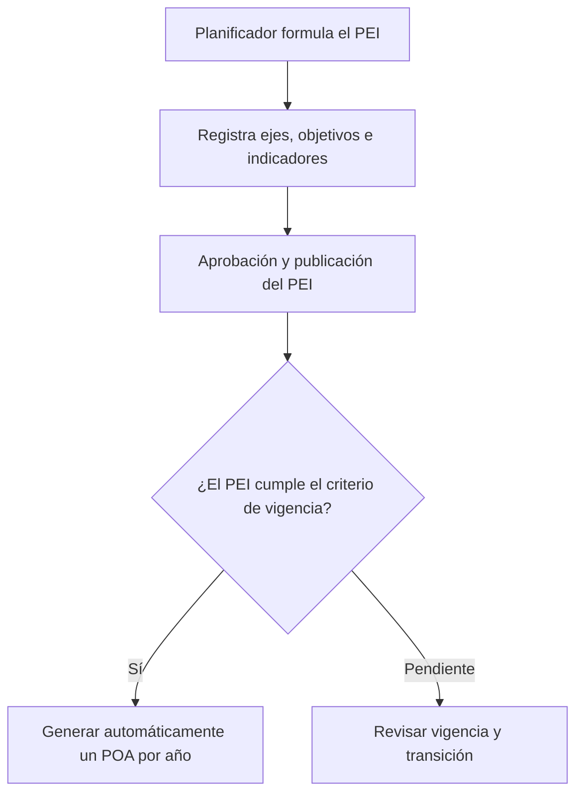
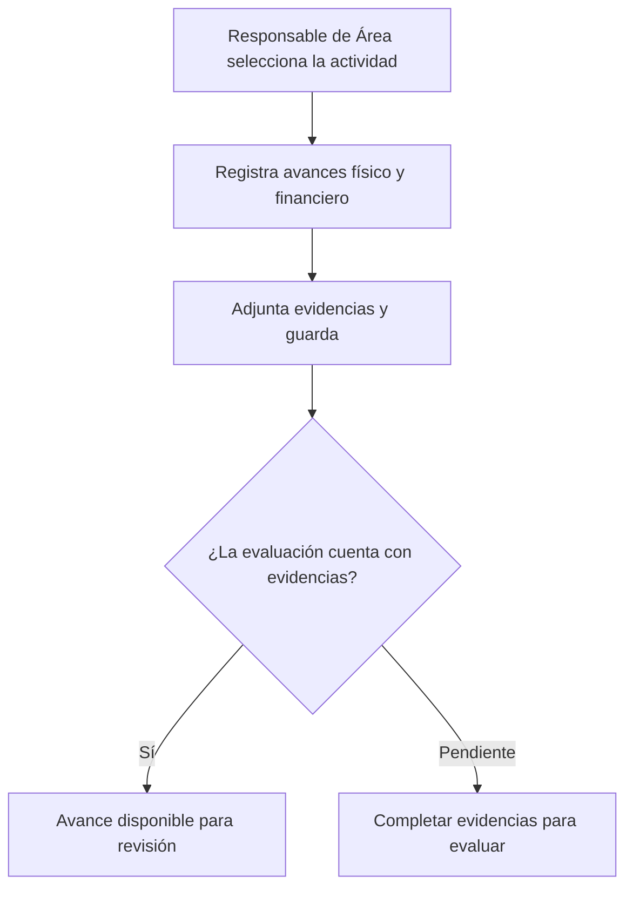
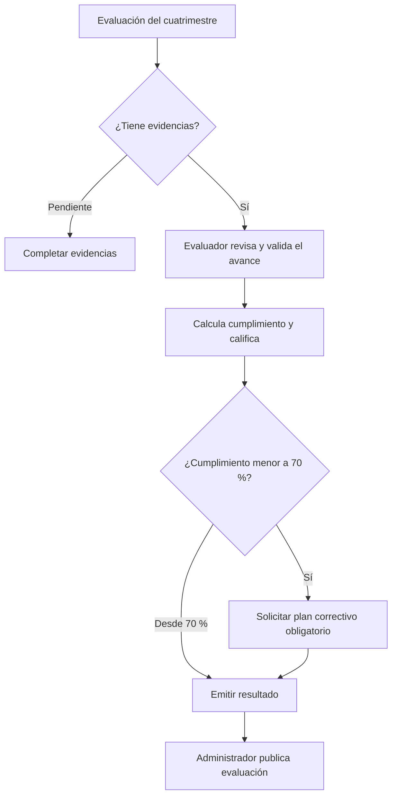
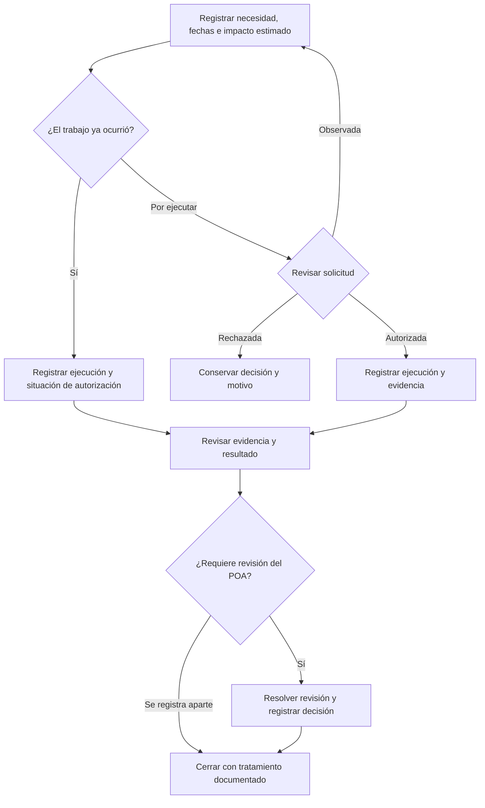
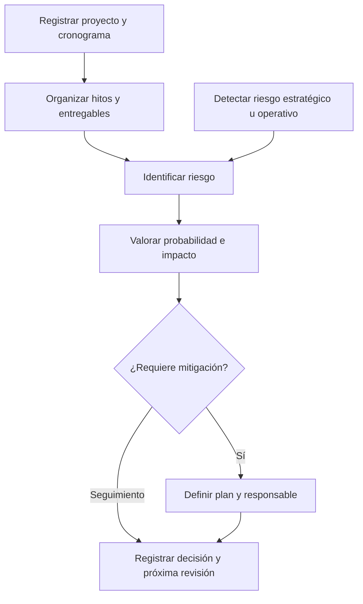

# Flujos funcionales de SISPLAN

> Referencia de diseño anterior a la base v1.0. Para implementar, aplica las decisiones del [plan base](01-PLAN-DE-CONSTRUCCION.md), [reglas](07-REGLAS-OPERATIVAS.md) y [herramientas](08-HERRAMIENTAS-Y-ENTORNOS.md).

El Plan Estratégico Institucional (PEI) fija los objetivos y los indicadores. El Plan Operativo Anual (POA) traduce esa estrategia en productos y actividades con responsables, metas y presupuesto. Cada avance conserva el vínculo con su actividad, período y evidencia, de modo que el evaluador pueda comprobar qué se ejecutó y a qué objetivo contribuye.

Este documento describe el diseño funcional para revisión. Los IDs `RF-`, `RN-`, `RNF-` y `CU-` corresponden al SRS. El prefijo `PROP-` identifica las propuestas para la ampliación de trabajo no planificado solicitada por el usuario. El repositorio registra la implementación del sistema institucional como **sin iniciar**. [Estado del proyecto](https://github.com/meliodr/Reto-desarollo-web-/blob/main/docs/ESTADO.md)

## 1. Formular el PEI y generar los POA

El Planificador Institucional registra el nombre, período, fechas, misión, visión, valores y estado del PEI. El ciclo ordinario abarca cuatro años y el extraordinario, cinco. Formula ejes, objetivos, resultados esperados, líneas de acción e indicadores con sus metas plurianuales. Cada indicador registra fórmula, unidad, línea base, meta y frecuencia. Los ejes admiten creación, modificación, inactivación y versionado. [SRS, §2.1 y RF-001 a RF-004, pp. 2–3 y 5–6](https://sisplan-reto-web-equipo.bzps4s5pp8.chatgpt.site/docs/SRS_SISPLAN.pdf#page=2)

El SRS exige generar automáticamente un POA por cada año y vincular todo POA con un PEI vigente. El caso oficial CU-001 incluye aprobar y publicar el PEI. El diagrama propone evaluar la vigencia como parte de la transición. Quedan por acordar el evento que dispara la generación, quién aprueba y publica el PEI y cómo se consultan los planes futuros e históricos. [SRS, RF-005, RN-001 y CU-001, pp. 6, 8 y 11](https://sisplan-reto-web-equipo.bzps4s5pp8.chatgpt.site/docs/SRS_SISPLAN.pdf#page=6)

| Relación | Información que debe poder rastrearse |
|---|---|
| Eje → objetivo | El eje del que forma parte el objetivo. |
| Objetivo → resultado, indicador y línea de acción | El indicador mide el resultado esperado y la línea de acción contribuye a lograrlo. |
| PEI → POA | El año operativo y su PEI. |
| Producto del POA → eje, objetivo e indicador | Los tres vínculos estratégicos exigidos por RF-006. |
| Producto → actividad | La actividad con cronograma, responsable y avance. |

El mapa estratégico previsto en el alcance puede mostrar estas relaciones. Los diagramas de negocio, estructura POA y modelo conceptual sirven de referencia. Sus cardinalidades y claves quedan para el modelo de datos. [SRS, §1.3, §4, §4.2 y §8, pp. 1, 4–5 y 9](https://sisplan-reto-web-equipo.bzps4s5pp8.chatgpt.site/docs/SRS_SISPLAN.pdf#page=4)

## 2. Programar productos y actividades

En el POA del año correspondiente se registra cada producto con su descripción, vínculos estratégicos, unidad de medida y responsable. El Planificador Institucional aprueba los productos del POA. El Responsable de Área crea actividades con cronograma y responsable asignado. La programación registra meta anual, mensual y cuatrimestral, junto con el presupuesto aplicable. Una actividad vencida genera una alerta automática. [SRS, §3.2–3.3, RF-006 a RF-009, RN-002 y RN-007, pp. 3–4, 6–7 y 9](https://sisplan-reto-web-equipo.bzps4s5pp8.chatgpt.site/docs/SRS_SISPLAN.pdf#page=3)

| Fuente de trabajo | Dato disponible | Qué debe resolver el equipo |
|---|---|---|
| Catálogo de ejes | Ejes, objetivos, resultados, indicadores y líneas de acción. | Identificar de forma única los objetivos cuya numeración se repite por eje. |
| POA TIC 2026 | Productos, responsables, unidades, metas mensuales y medios de verificación. | Validar el eje, objetivo e indicador de cada producto. Diferenciar rótulos repetidos, presupuesto ausente y actividades pendientes de detalle. |
| Programación del POA | Meses agrupados visualmente en cuatro trimestres en el Excel. | Aplicar los tres cuatrimestres del SRS para evaluar. Acordar cómo se agregan cantidades, porcentajes e hitos. |

Fuentes de datos del reto. [Ejes y Objetivos DIGEMAPS](https://sisplan-reto-web-equipo.bzps4s5pp8.chatgpt.site/docs/Ejes_y_Objetivos_DIGEMAPS.xlsx) · [POA TI 2026 V2](https://sisplan-reto-web-equipo.bzps4s5pp8.chatgpt.site/docs/POA_TI_2026.xlsx)

## 3. Registrar ejecución y evidencias

CU-002 define el recorrido del Responsable de Área. Selecciona la actividad, registra el avance, adjunta la evidencia y guarda. El avance incluye información física y financiera, comentarios y evidencias. El sistema admite PDF, Word, Excel, imágenes y enlaces. El porcentaje de avance tiene un límite de 100 %. [SRS, RF-010, RF-011, RN-006 y CU-002, pp. 7, 9 y 11](https://sisplan-reto-web-equipo.bzps4s5pp8.chatgpt.site/docs/SRS_SISPLAN.pdf#page=7)

Para comprobar un avance, deben poder recuperarse la actividad, dependencia, período, valores registrados, unidad y archivos o enlaces asociados. La política de borradores incompletos, el número de avances por período, las correcciones y el efecto de una ejecución superior a la meta son decisiones de diseño. La gestión documental incluye versionamiento y la auditoría registra usuario, fecha, cambio, valor anterior y nuevo. [SRS, §1.3, RN-005 y RNF-002, pp. 2 y 9](https://sisplan-reto-web-equipo.bzps4s5pp8.chatgpt.site/docs/SRS_SISPLAN.pdf#page=2)

## 4. Evaluar, corregir y publicar

Cada POA genera automáticamente tres evaluaciones obligatorias: **enero–abril**, **mayo–agosto** y **septiembre–diciembre**. El Evaluador verifica las evidencias, valida avances, califica el cumplimiento y emite el resultado. El Administrador publica evaluaciones. [SRS, §2.3, §3.1, §3.4, RF-012 y CU-003, pp. 3–4, 7 y 11](https://sisplan-reto-web-equipo.bzps4s5pp8.chatgpt.site/docs/SRS_SISPLAN.pdf#page=3)

La fórmula del SRS es **ejecutado ÷ programado × 100**. Deben compararse valores de la misma unidad y período. La relación entre cálculo y calificación, y las condiciones para emitir, cerrar o publicar cuando hay un correctivo pendiente, todavía requieren acuerdo. El diagrama muestra la solicitud del plan correctivo. [SRS, RF-013 a RF-015 y RN-008, pp. 7–9](https://sisplan-reto-web-equipo.bzps4s5pp8.chatgpt.site/docs/SRS_SISPLAN.pdf#page=7)

| Estado | Umbral documentado |
|---|---|
| Verde | Desde 90 %. |
| Amarillo | 70 %–89 %. |
| Rojo | Menor a 70 %. Requiere plan correctivo. |

La clasificación de los decimales entre 89 % y 90 % queda pendiente. La propuesta aplica amarillo desde 70 % hasta menos de 90 % y calcula el estado antes de redondear. También quedan pendientes la meta cero, la sobreejecución y los métodos de consolidación por institución, eje, área, objetivo e indicador. [SRS, RF-013, RF-014, RF-016 y §9, pp. 7–10](https://sisplan-reto-web-equipo.bzps4s5pp8.chatgpt.site/docs/SRS_SISPLAN.pdf#page=7)

### Consultar resultados y alertas

- El dashboard presenta PEI y POA vigentes, cumplimiento institucional y resultados por eje, área e indicador. Los indicadores clave del SRS también incluyen cumplimiento por objetivo, ejecución presupuestaria, actividades completadas y productos entregados. [SRS, RF-016 y §9, pp. 8–10](https://sisplan-reto-web-equipo.bzps4s5pp8.chatgpt.site/docs/SRS_SISPLAN.pdf#page=8)
- Se generan seis informes: **PEI, POA, cuatrimestral, anual, de indicadores y presupuestario**. PDF y Excel figuran en la arquitectura recomendada. El Consultor consulta, visualiza el dashboard y descarga reportes. Consulta Ejecutiva accede a dashboards. [SRS, §3.5–3.6, RF-017 y §10, pp. 4, 8 y 10](https://sisplan-reto-web-equipo.bzps4s5pp8.chatgpt.site/docs/SRS_SISPLAN.pdf#page=4)
- Las alertas cubren evaluaciones pendientes, actividades vencidas, indicadores sin actualizar e incumplimientos. Destinatarios, plazos, canales y prevención de duplicados requieren definición. [SRS, RF-018 y RN-007, pp. 8–9](https://sisplan-reto-web-equipo.bzps4s5pp8.chatgpt.site/docs/SRS_SISPLAN.pdf#page=8)

## 5. Gestionar trabajo no planificado

La ampliación solicitada incorpora actividades que surgen fuera de la programación aprobada. El flujo siguiente y sus permisos son **propuestas pendientes de acuerdo**. El registro conserva su origen, motivo, dependencia, responsable, fechas reales y relación con el POA. La clasificación estratégica puede quedar pendiente durante la solicitud. Si la incorporación genera un producto operativo, se aplican los vínculos exigidos por RF-006. [Ampliación de actividades no planificadas](https://github.com/meliodr/Reto-desarollo-web-/blob/main/docs/AMPLIACION-NO-PLANIFICADA.md)

En los hechos reportados después de ocurrir, se guardan por separado la fecha real de ejecución, la fecha de registro y la fecha de la decisión. El estado de autorización refleja lo que consta en el historial. El cierre del diagrama presupone resultado revisado y tratamiento del impacto resuelto. Los casos de observación, cancelación, reapertura y aprobación de una revisión requieren transiciones explícitas. [Ampliación de actividades no planificadas](https://github.com/meliodr/Reto-desarollo-web-/blob/main/docs/AMPLIACION-NO-PLANIFICADA.md)

| Elemento | Tratamiento propuesto |
|---|---|
| Metas y cronograma | Registrar estimaciones y metas propias si aplican. Una revisión aprobada identifica los cambios y su fecha de vigencia. |
| Presupuesto | Distinguir costo estimado, autorizado y real. Tramitar cualquier cambio presupuestario mediante el permiso que se acuerde. |
| Indicadores | Aplicar el efecto de la actividad solo cuando exista un vínculo válido y una regla de medición acordada. Mostrar la meta, unidad, período y versión utilizados. |
| Evidencias | Asociar los documentos y su revisión al hecho ejecutado. Compartir la referencia si se incorpora el trabajo al POA. |
| Línea base del POA | Conservar la versión aprobada de referencia y la revisión autorizada. Distinguir esta versión de la línea base de medición de un indicador. |
| Reportes | Distinguir actividad originalmente planificada, adicional registrada aparte y adicional incorporada. Contar cada ejecución y costo una sola vez. |

Los candidatos iniciales son el Responsable de Área para registrar y ejecutar, el Planificador para revisar el vínculo y tramitar cambios, y el Evaluador para revisar evidencias. Debe acordarse quién autoriza el trabajo, el gasto, la revisión del POA y el cierre. Las facultades de consulta y decisión se limitan al rol y la dependencia definidos en la matriz de permisos. [Ampliación de actividades no planificadas](https://github.com/meliodr/Reto-desarollo-web-/blob/main/docs/AMPLIACION-NO-PLANIFICADA.md)

## 6. Proyectos y riesgos

El alcance original incluye portafolios, programas, proyectos, cronogramas, hitos y entregables. También incluye riesgos estratégicos y operativos, una matriz de probabilidad e impacto y planes de mitigación. El flujo siguiente propone cómo conectar estos conceptos. Los permisos, los vínculos obligatorios y las escalas requieren acuerdo. [SRS, §1.3, p. 2](https://sisplan-reto-web-equipo.bzps4s5pp8.chatgpt.site/docs/SRS_SISPLAN.pdf#page=2)

Para un proyecto, se propone registrar su vínculo con el programa o portafolio aplicable, su contribución a la estrategia y sus actividades del POA cuando corresponda. Para un riesgo, se propone registrar el contexto, la valoración, la decisión de tratamiento y la fecha de revisión. Un riesgo detectado en la estrategia o en una actividad puede seguir el mismo proceso de valoración. El equipo debe definir la escala, el criterio de mitigación y quién revisa cada caso. [Decisiones del proyecto](https://github.com/meliodr/Reto-desarollo-web-/blob/main/docs/DECISIONES.md)

## 7. Transiciones por entidad

Las secuencias de esta tabla son propuestas para preparar la matriz de permisos. La última columna identifica las acciones y restricciones que ya tienen respaldo en el SRS. Se deben acordar las devoluciones, reaperturas y correcciones antes de cerrar cada secuencia.

| Entidad | Secuencia propuesta | Base confirmada |
|---|---|---|
| PEI | Borrador → en revisión → aprobado → publicado. Acordar cuándo entra en vigencia. | CU-001 incluye aprobar y publicar. RN-001 vincula el POA con un PEI vigente. |
| POA | Generado → en formulación → en revisión → en seguimiento → cerrado. Acordar aprobación y cierre. | RF-005 genera un POA por año. El SRS asigna al Planificador la aprobación de productos. |
| Producto | Borrador → en revisión → aprobado → en seguimiento. Una observación devuelve el registro para corrección. | El Planificador aprueba productos. RF-006 exige los vínculos estratégicos. |
| Actividad | Programada → en ejecución → ejecutada. El vencimiento se detecta a partir del cronograma. | RF-008 prevé cronograma. RN-002 exige responsable y RN-007 exige alerta automática por vencimiento. |
| Avance y evidencia | Avance registrado → en revisión → validado u observado. Conservar observaciones y versiones de evidencia. | CU-002 registra el avance con evidencia. CU-003 verifica evidencia y valida avances. |
| Evaluación | Generada → en revisión → resultado emitido → publicada. Acordar cierre y reapertura. | RF-012 genera evaluaciones. RN-005 exige evidencias. El Evaluador emite el resultado y el Administrador publica. |
| Plan correctivo | Solicitado → presentado → en seguimiento → revisado. Acordar responsables, plazos y cierre. | RF-015 y RN-008 exigen el plan cuando el cumplimiento es menor a 70 %. |
| Trabajo no planificado | Borrador → solicitado → autorizado → en ejecución → pendiente de validación → cerrado. Acordar rutas observadas, rechazadas, canceladas y de registro posterior. | Ampliación solicitada por el usuario. El flujo se describe en la sección 5. |

RN-0098 protege los registros aprobados frente a eliminación y RNF-002 exige registrar sus cambios. La política de corrección por versión, las transiciones permitidas y los roles autorizados quedan para la matriz común. [SRS, §6–7, pp. 8–9](https://sisplan-reto-web-equipo.bzps4s5pp8.chatgpt.site/docs/SRS_SISPLAN.pdf#page=9)

## 8. Pruebas de recorrido propuestas

| Caso | Resultado esperado | Trazabilidad |
|---|---|---|
| PEI ordinario 2026–2029 con datos de demostración. | Se crean cuatro POA, uno por año, con referencia al mismo PEI. | RF-001, RF-005 y RN-001. |
| Crear una actividad sin responsable o dejar vencer una con cronograma. | La primera requiere responsable. La segunda genera la alerta automática prevista. | RF-008, RF-018, RN-002 y RN-007. |
| Programar tres jornadas y ejecutar dos en enero–abril con acta de respaldo. | El cálculo de ejemplo es 66,67 %, estado rojo y solicitud de plan correctivo. El registro permite volver al producto y a sus vínculos estratégicos. | RF-006, RF-010 a RF-015, RN-005 y RN-008. |
| Evaluar sin evidencia o intentar eliminar un aprobado. | El primer caso queda pendiente de evidencia. El registro aprobado se conserva. | RN-005 y RN-0098. |
| Registrar una actividad adicional sin meta numérica ni incorporación aprobada. | Se consulta su ejecución y evidencia por origen. El cumplimiento queda sin denominador aplicable y el POA conserva su versión de referencia. | PROP-RF-NP-004, PROP-RF-NP-008 y PROP-RN-NP-002 a PROP-RN-NP-004. |
| Incorporar por revisión una actividad adicional con ejecución registrada. | Se pueden consultar original, revisión, motivo, responsable de la decisión y fecha. La ejecución y el costo se contabilizan una vez. | PROP-RF-NP-007, PROP-RN-NP-001, PROP-RN-NP-006 y RNF-002. |

Los casos usan datos de prueba y tienen ejecución pendiente. Como controles transversales, se verifican OAuth2, OpenID Connect y MFA, junto con la auditoría de cambios. El SRS incluye MFA en RNF-001 y en el apartado A+. El alcance de correo y aprobación de documentos figura en ese mismo apartado. [SRS, §7 y A+, pp. 9 y 11](https://sisplan-reto-web-equipo.bzps4s5pp8.chatgpt.site/docs/SRS_SISPLAN.pdf#page=9)

## 9. Decisiones para cerrar el diseño

| Área | Decisión pendiente |
|---|---|
| Vigencia y generación | Evento de generación anual, coexistencia de ciclos y acceso a años futuros e históricos. |
| Aprobaciones | Responsables y transiciones por entidad, correcciones de aprobados y publicación. |
| Dependencias | Estructura del POA institucional, alcance de datos por área y delegación. |
| Evaluación | Meta cero, sobreejecución, decimales, calificación y método de consolidación. |
| Presupuesto | Moneda, partidas, diferencia entre aprobado y ejecutado, autorizaciones y revisiones. |
| Proyectos y riesgos | Vinculación con estrategia y operación, cronogramas, hitos, entregables, matriz probabilidad–impacto y mitigaciones. El SRS los incluye en alcance general y el flujo detallado requiere especificación. |
| Trabajo no planificado | Clasificación, autoridad de decisión, registro posterior, fecha efectiva de revisión y criterios de cierre. |

La matriz de permisos, el modelo lógico y las pruebas de aceptación deberán recoger los acuerdos. [Decisiones del proyecto](https://github.com/meliodr/Reto-desarollo-web-/blob/main/docs/DECISIONES.md)
