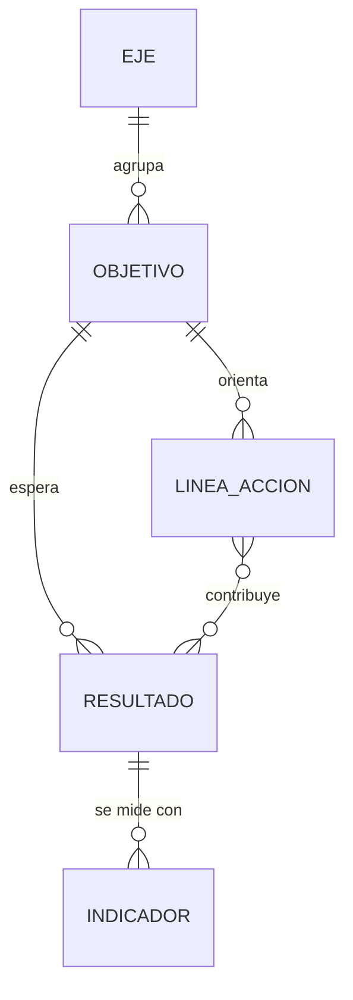
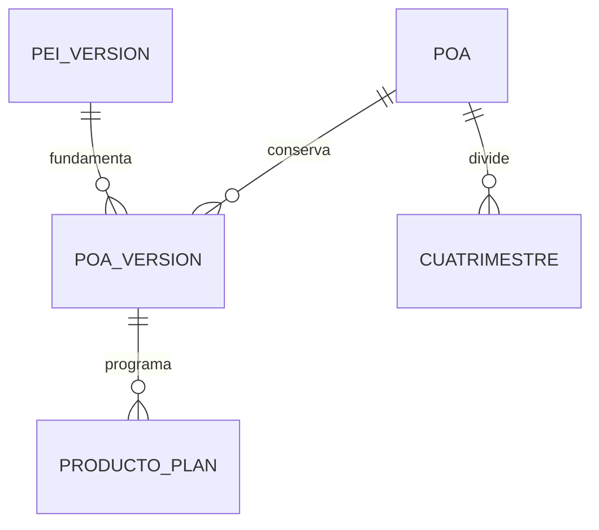
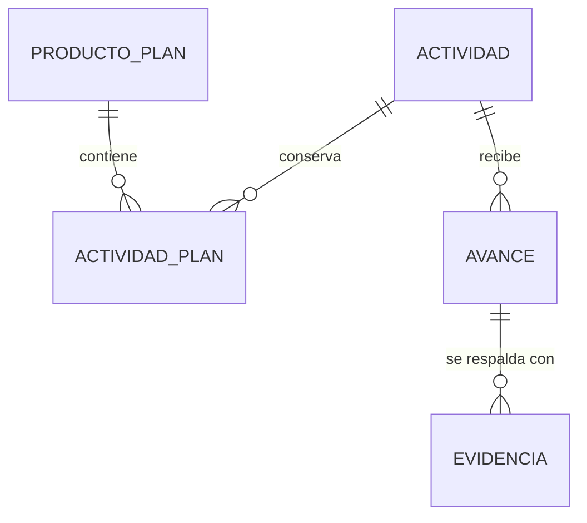
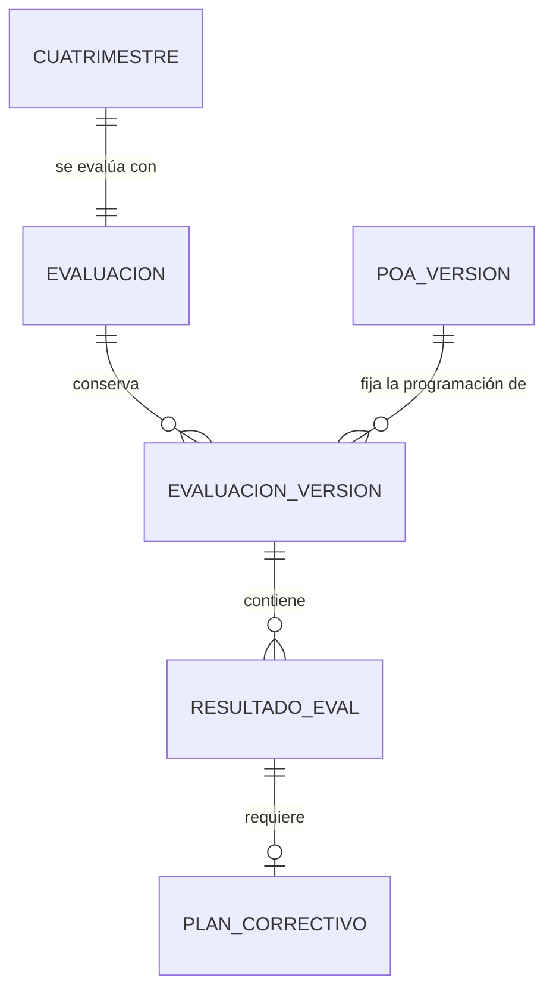

# 03 · Datos, API, acceso y pruebas de SISPLAN

Angular es la decisión confirmada para el frontend. Este capítulo propone Angular 22, Node 24 desde 24.15, TypeScript 6.0, ASP.NET Core Web API sobre .NET 10 LTS y PostgreSQL 18. Para persistencia propone EF Core 10 con Npgsql 10. Las versiones se fijarán en los archivos de proyecto y CI al iniciar el desarrollo. La recomendación cumple los rangos .NET 9 o superior y PostgreSQL 16 o superior del SRS. [Compatibilidad de Angular](https://angular.dev/reference/versions) · [Soporte de .NET](https://dotnet.microsoft.com/en-us/platform/support/policy/dotnet-core) · [PostgreSQL 18](https://www.postgresql.org/docs/18/) · [Npgsql 10 para EF Core](https://www.npgsql.org/efcore/release-notes/10.0.html).

El punto de partida es el SRS SISPLAN v1.0, sus diagramas de las páginas 4, 5 y 9 y los dos Excel de referencia. El repositorio registra la implementación institucional sin iniciar. Los contratos, las cardinalidades y los escenarios de este capítulo están propuestos para implementar y verificar. [Estado del proyecto](https://github.com/meliodr/Reto-desarollo-web-/blob/main/docs/ESTADO.md).

## Modelo de datos propuesto

El PEI, el POA, los productos y las actividades conservan una identidad estable. Sus versiones identifican exactamente la programación revisada o aprobada. Una evaluación publicada referencia la versión del POA, las revisiones de avance y las evidencias utilizadas en su cálculo.



Cada eje pertenece a una versión del PEI. El indicador mide un resultado del mismo objetivo. Una tabla de vínculo conserva qué resultados reciben aportes de cada línea de acción. Códigos, fórmulas, unidades, línea base, frecuencia y metas plurianuales se consultan en su versión estratégica.



El POA pertenece a un PEI y tiene un año único dentro de ese plan. El producto programado conserva la relación estratégica mediante el indicador de la misma versión del PEI. La API valida y muestra también el objetivo y eje que se obtienen de ese vínculo. Un producto puede tener varias actividades y cada actividad tiene un responsable identificado.



`ACTIVIDAD_PLAN` define cronograma, responsable, metas, presupuesto asociado y **medio de verificación esperado**. `EVIDENCIA` guarda los documentos o enlaces entregados, con su versión y revisión. Por ejemplo, «lista de asistencia» es un medio esperado y el PDF específico firmado es una evidencia entregada. La referencia al indicador del producto acompaña la actividad durante el seguimiento.



| Grupo | Entidades y reglas de persistencia |
|---|---|
| Estrategia | `pei`, `pei_version`, `eje`, `objetivo`, `resultado`, `linea_accion`, `linea_resultado`, `indicador`, `meta_estrategica`. Las filas versionadas conservan una clave lógica para comparar revisiones. |
| Operación | `poa`, `poa_version`, `producto`, `producto_plan`, `actividad`, `actividad_plan`, `meta_programada`, `medio_verificacion`. Meta anual y metas por mes o cuatrimestre identifican unidad, período y regla de consolidación. |
| Organización | `dependencia`, `usuario`, `rol`, `asignacion_rol`. La identidad externa se vincula mediante `issuer` y `subject`. La asignación indica alcance institucional o dependencias autorizadas. |
| Ejecución | `avance` identifica actividad y cuatrimestre. `avance_version` conserva el total informado del período, el avance declarado, el monto ejecutado, comentarios y estado de validación. Para el cálculo se toma una revisión aplicable por actividad y período. |
| Evidencias | `evidencia`, `evidencia_version` y vínculo con la revisión de avance. Guardar título, tipo, autor, fecha, referencia privada del archivo o enlace, suma de comprobación y estado. |
| Evaluación | `cuatrimestre`, `evaluacion`, `evaluacion_version`, `resultado_eval`, `plan_correctivo`. Cada resultado conserva insumos, unidad, denominador, cálculo aplicado, semáforo y trazas de evidencia. |
| Presupuesto | `asignacion_presupuestaria` por versión, dependencia y producto, con actividad opcional. Los importes aprobados y ejecutados se consultan por moneda y período. El detalle de partidas y reasignación requiere acuerdo. |
| Proyectos | `portafolio` agrupa `programa`, `programa` agrupa `proyecto`. Cada proyecto relaciona productos del POA, cronograma, hitos y entregables. La profundidad de controles y permisos queda por precisar. |
| Riesgos | `riesgo` vinculado a un objetivo estratégico o actividad operativa mediante claves foráneas, `valoracion_riesgo` con probabilidad, impacto y versión de escala, `mitigacion` con responsable, plazo y seguimiento. Escalas, matriz y criterios de cierre requieren acuerdo. |
| Ampliación solicitada | `solicitud_no_planificada`, `decision_incorporacion` y vínculo a la actividad incorporada. La solicitud conserva su origen, fechas reales, estado de autorización y efectos estimados. La ejecución se registra una vez y se referencia desde ambos expedientes. [Ampliación](https://github.com/meliodr/Reto-desarollo-web-/blob/main/docs/AMPLIACION-NO-PLANIFICADA.md). |
| Control | `auditoria` con actor, instante, acción, entidad, antes/después y correlación. `evento_pendiente` y `alerta` conservan entregas y deduplicación por tipo, entidad, período y destinatario. |

### Restricciones y transacciones

- `UNIQUE(pei_id, anio)` para POA, `UNIQUE(poa_id, numero)` para cuatrimestres y `UNIQUE(cuatrimestre_id)` para la evaluación. Cada POA genera enero–abril, mayo–agosto y septiembre–diciembre con una evaluación por período. La activación o publicación acordada del PEI genera los POA en una transacción. Un reintento recupera los ya generados.
- Las claves foráneas compuestas validan que indicador y POA correspondan a la misma versión estratégica. Las relaciones de organización, fechas dentro del año y transiciones se validan también en el servicio. [Restricciones de PostgreSQL](https://www.postgresql.org/docs/18/ddl-constraints.html).
- Usar `numeric` para cantidades y dinero, `date` para calendario institucional y `timestamptz` para acciones. Los meses se agrupan de acuerdo con el cuatrimestre. La zona de calendario propuesta es `America/Santo_Domingo`. Los datos ausentes se conservan como `null`.
- Las versiones aprobadas quedan protegidas de eliminación conforme a RN-0098. Una corrección genera una versión identificable. La autorización del cambio, la versión y la auditoría se guardan juntas. La emisión de un resultado rojo registra en la misma transacción el plan correctivo requerido y el evento de alerta.
- Un token de concurrencia se actualiza en cada cambio del registro. Si una edición de un hijo afecta una aprobación o evaluación, también actualiza la versión del conjunto que se aprobará. EF Core compara el token al guardar. [Concurrencia en EF Core](https://learn.microsoft.com/en-us/ef/core/saving/concurrency).

### Cálculo y consistencia de reportes

RF-013 define `ejecutado / programado × 100`. Con meta positiva, la propuesta compara sin redondear para clasificar rojo debajo de 70 %, amarillo desde 70 % hasta menos de 90 % y verde desde 90 %. El valor mostrado conserva precisión suficiente para explicar la clasificación. Para meta igual a cero o ausente, se propone mostrar «Sin base de cálculo» y registrar el caso para revisión.

RN-006 limita el avance al 100 %. Registrar por separado cantidad ejecutada y avance porcentual permite conservar la ejecución real. El tratamiento de sobreejecución, valores negativos y excepciones debe acordarse antes de cerrar la fórmula de evaluación. El correctivo se exige al emitir un resultado de cumplimiento inferior a 70 % con base válida.

Cada indicador declara método de consolidación, unidad y fuente. Cantidades acumulables pueden sumarse por período. Tasas, tiempos, saldos y porcentajes requieren su regla particular. Mientras falten ponderaciones institucionales, el dashboard puede mostrar resultados individuales y el agregado como pendiente de definición. Los seis reportes, el dashboard y la exportación consumen la misma consulta de resultados publicados y su versión.

## Persistencia y operación

Proponer una API modular con módulos de estrategia, operación, evaluación, evidencias, presupuesto, proyectos, riesgos, reportes, alertas y acceso. En PostgreSQL se aplican migraciones EF Core revisadas y probadas desde una base vacía y desde la revisión anterior. El despliegue aplica el script o paquete de migración como paso explícito. Un respaldo y una restauración en un entorno aislado verifican recuperación. [Migraciones de EF Core](https://learn.microsoft.com/en-us/ef/core/managing-schemas/migrations/applying).

Los archivos se guardan en almacenamiento privado de objetos. PostgreSQL conserva metadatos y referencias. La API comprueba tipo, tamaño, permiso y asociación al avance. Un archivo queda disponible después de confirmar la escritura y su registro. Un fallo parcial deja un estado recuperable y permite limpiar objetos huérfanos. Los enlaces se validan como HTTPS y se presentan para consulta. La descarga requiere permiso sobre el registro y entrega un enlace temporal o un flujo autorizado.

La importación de Excel empieza en un área de revisión con documento, hoja, fila e identificación de origen. Se comprueba que los seis ejes y veinte objetivos conservan los textos originales. Los once productos conservan su numeración original como dato de fuente, incluso el rótulo repetido. Los vínculos a objetivo e indicador, las actividades faltantes y el presupuesto vacío requieren revisión antes de aceptar datos operativos. La demo usa registros ficticios identificados como tales.

## Autenticación y permisos

Angular inicia la sesión con OpenID Connect mediante Authorization Code y PKCE. La biblioteca OIDC gestiona redirección, estado de la sesión y token de acceso en memoria. El proveedor de identidad aplica MFA y se seleccionará tras comprobar integración y operación. Si ofrece renovación a clientes públicos, aplicar el mecanismo seguro de rotación o vinculación que se configure. [IETF RFC 9700](https://www.rfc-editor.org/rfc/rfc9700.html).

La API recibe el token de acceso mediante `Authorization: Bearer`, comprueba firma, emisor, audiencia y vigencia, y vincula la identidad al usuario activo. `GET /api/v1/me` devuelve sus roles, dependencias y capacidades de interfaz. Los permisos se comprueban en cada recurso, también en listados, descargas y reportes. Los guards de Angular organizan la navegación. [JWT bearer en ASP.NET Core](https://learn.microsoft.com/en-us/aspnet/core/security/authentication/configure-jwt-bearer-authentication?view=aspnetcore-10.0).

| Rol del SRS | Acciones de referencia para la matriz |
|---|---|
| Administrador | Catálogos, configuración de indicadores, usuarios y publicación de evaluaciones. |
| Planificador Institucional | Formular PEI, gestionar POA, aprobar productos, consolidar avances y elaborar informes. |
| Responsable de Área | Crear actividades, registrar avances, adjuntar evidencias y actualizar indicadores dentro de su ámbito. |
| Evaluador | Revisar evidencias, validar avances y emitir calificación. |
| Consultor | Consultas, dashboard y descarga de reportes. |
| Consulta Ejecutiva | Acceso al dashboard. |

La matriz debe resolver quién aprueba y publica PEI, qué permisos se delegan por dependencia, quién ve la auditoría y quién autoriza cambios al POA. MFA figura en RNF-001 y en A+. Se mantiene como criterio de verificación pendiente de aclaración y se demuestra con el flujo real del proveedor elegido. Los integrantes del equipo de desarrollo se organizan con independencia de esta matriz.

## Contrato API inicial

Las rutas usan el prefijo `/api/v1`. Los listados aceptan filtros, paginación y orden estable. Las respuestas usan identificadores estables y campos de versión. Las cantidades decimales y los importes se transmiten como cadenas decimales con unidad o moneda, para conservar precisión entre .NET y TypeScript. Los filtros de contexto se aplican en servidor.

| Recurso | Operación propuesta | Requisito y resultado |
|---|---|---|
| Sesión y administración | `GET /me`, `GET /dependencias`, `GET/POST /usuarios`, `PUT /usuarios/{id}/roles` | RNF-001 y administración. Acceso y alcance autorizado. |
| PEI | `GET/POST /peis`, `POST /peis/{id}/versiones`, `GET/PATCH /pei-versiones/{id}`, `POST /pei-versiones/{id}/transiciones` | RF-001 y CU-001. Formular, revisar y publicar según matriz. |
| Elementos estratégicos | `GET/POST /pei-versiones/{id}/{coleccion}`, `PATCH /{coleccion}/{id}` | RF-002 a RF-004. Edición e inactivación dentro de la versión de trabajo. |
| POA | `GET /peis/{id}/poas`, `GET /poas/{id}`, `POST /poas/{id}/versiones` | RF-005. Consulta de planes anuales generados y revisión identificable. |
| Producto | `GET/POST /poa-versiones/{id}/productos`, `PATCH /productos-plan/{id}`, `POST /productos-plan/{id}/aprobar` | RF-006 y RF-007. Vínculo estratégico, unidad y responsable. |
| Actividad y programación | `GET/POST /productos-plan/{id}/actividades`, `PATCH /actividades-plan/{id}`, `PUT /actividades-plan/{id}/programacion` | RF-008 y RF-009. Cronograma, responsable, medio esperado y metas. |
| Presupuesto | `GET/PUT /poa-versiones/{id}/presupuesto` | Programación y comparación de importes por ámbito, período y moneda. |
| Avance | `GET/POST /actividades/{id}/avances`, `PATCH /avances/{id}`, `POST /avances/{id}/enviar` | RF-010 y CU-002. Cantidades físicas, financieras y comentarios. |
| Evidencia | `POST /avances/{id}/evidencias`, `POST /evidencias/{id}/versiones`, `GET /evidencias/{id}/versiones/{n}/contenido` | RF-011. Archivo o enlace, versiones y descarga autorizada. |
| Evaluación | `GET /poas/{id}/evaluaciones`, `GET /evaluaciones/{id}`, `POST /evaluaciones/{id}/revisiones`, `POST /evaluaciones/{id}/emitir`, `POST /evaluaciones/{id}/publicar` | RF-012 a RF-014 y CU-003. La revisión vincula una versión de avance con sus evidencias, decisión y observaciones. |
| Correctivos | `GET /evaluaciones/{id}/correctivos`, `PATCH /planes-correctivos/{id}` | RF-015. Solicitud automática y seguimiento del plan. |
| Consulta | `GET /dashboard`, `GET /actividades/{id}/trazabilidad` | RF-016. Filtros de PEI, POA, eje, dependencia, indicador y período. |
| Reportes | `GET /reportes/{tipo}?formato=pdf\|xlsx` | RF-017. Tipos `pei`, `poa`, `cuatrimestral`, `anual`, `indicadores` y `presupuestario`. |
| Alertas | `GET /alertas`, `PATCH /alertas/{id}` | RF-018. Evaluación pendiente, actividad vencida, indicador sin actualizar e incumplimiento. |
| Auditoría | `GET /auditoria?entidadTipo=...&entidadId=...` | RNF-002. Consulta autorizada por entidad, actor y período. |
| Proyectos | Colecciones `/portafolios`, `/programas`, `/proyectos` y recursos de cronograma, hitos y entregables | Alcance de §1.3. Contrato detallado cuando se acuerde la profundidad. |
| Riesgos | Colección `/riesgos`, recursos `/valoraciones` y `/mitigaciones` | Alcance de §1.3. Matriz probabilidad-impacto y seguimiento. |
| Trabajo no planificado | `GET/POST /solicitudes-no-planificadas`, `PATCH /solicitudes-no-planificadas/{id}`, comandos `/enviar`, `/decisiones` y `/incorporar` | Ampliación solicitada. Autorización e incorporación controladas, con permisos por acordar. |

Las colecciones estratégicas son `ejes`, `objetivos`, `resultados`, `lineas-accion` e `indicadores`. El contrato OpenAPI fijará DTO, tipos, permisos y ejemplos antes de integrar las pantallas. La generación anual y cuatrimestral se realiza como parte del flujo, con operaciones repetibles sin duplicación.

El siguiente ejemplo muestra la forma propuesta de `GET /me` con una cuenta ficticia.

```json
{
  "usuario": {"id": "11111111-1111-4111-8111-111111111111", "nombreVisible": "Responsable de prueba"},
  "roles": ["responsable-area"],
  "dependencias": [{"id": "22222222-2222-4222-8222-222222222222", "nombre": "Tecnología"}],
  "capacidades": ["actividades.crear", "avances.registrar", "evidencias.adjuntar"]
}
```

Las consultas de edición devuelven `ETag`. Las mutaciones de recursos existentes envían `If-Match`. Una revisión desactualizada devuelve `412`, una transición incompatible devuelve `409` y un error de campos devuelve `422`. `401` solicita autenticación, `403` indica falta de permiso y `404` cubre un recurso no disponible para el ámbito de consulta. Los errores usan `application/problem+json` y un código estable para la interfaz. [HTTP Semantics, If-Match](https://www.rfc-editor.org/rfc/rfc9110.html#name-if-match).

```json
{
  "type": "/problemas/validacion",
  "title": "Revisa los datos del avance",
  "status": 422,
  "code": "EVIDENCIA_REQUERIDA",
  "errors": {
    "evidencias": ["Adjunta una evidencia disponible antes de enviar."]
  },
  "traceId": "referencia-de-la-solicitud"
}
```

Para notificar, un proceso periódico identifica las cuatro condiciones de RF-018. El registro de alertas mantiene un identificador de deduplicación y la fecha de entrega. Los destinatarios, frecuencia, definiciones de vencimiento y canales se acuerdan con cada módulo. El correo queda como integración adicional conforme al apartado A+.

## Plan de pruebas y evidencia

La suite de dominio comprueba cálculos, períodos y transiciones. La suite de integración ejecuta API, migraciones, transacciones y permisos con PostgreSQL 18 desechable. El recorrido de navegador une Angular, API, proveedor de identidad y almacenamiento de evidencias. Cada prueba registra requisito, versión, rol, datos, resultado esperado, resultado obtenido y evidencia.

| Caso | Cobertura | Resultado que se debe comprobar |
|---|---|---|
| QA-01 | RF-001 a RF-004, CU-001 | Crear PEI ordinario y extraordinario, registrar objetivos, resultados, líneas e indicadores, recuperar borrador y consultar versiones. |
| QA-02 | RF-005, RF-012, RN-001 | Generar cuatro o cinco POA según ciclo y tres cuatrimestres por POA. Repetir operación y comprobar unicidad. |
| QA-03 | RF-006 a RF-009, RN-002 | Rechazar vínculos de otra versión estratégica o actividad sin responsable. Conservar unidad, medio esperado y programación del período. |
| QA-04 | RF-010, RF-011, CU-002, RN-006 | Guardar avance físico y financiero con evidencia. Recuperar tras recarga, conservar revisiones y rechazar porcentaje declarado superior a 100 %. |
| QA-05 | RF-012, RF-013, RF-014, RN-005, CU-003 | Emitir evaluación con evidencia, comprobar 69.99 %, 70 %, 89.99 % y 90 %. Verificar el tratamiento acordado de meta cero, ausencia de meta y sobreejecución. |
| QA-06 | RF-015, RN-008 | Con un resultado rojo se registra un correctivo obligatorio y una alerta. Repetir el comando y comprobar unicidad. |
| QA-07 | RF-016, RF-017 | Comparar dashboard y los seis reportes PDF/Excel con la misma versión, período y filtros. Verificar presupuesto por moneda y cifras nulas diferenciadas. |
| QA-08 | RF-018, RN-007 | Simular el reloj y provocar las cuatro condiciones. Verificar destinatario, lectura y ausencia de alertas duplicadas al repetir el procesamiento. |
| QA-09 | RNF-001 | Probar acceso con OIDC y MFA en el proveedor elegido, expiración, roles incorrectos, cambios de dependencia y descarga ajena. Comprobar 401/403 y control de ámbito en servidor. |
| QA-10 | RNF-002, RN-0098 | Intentar borrar un aprobado y conservar registro e historial. Revisar valores anterior/nuevo, actor y fecha. Simular dos revisiones simultáneas y comprobar 412 sin sobrescritura. |
| QA-11 | Proyectos y riesgos | Verificar vínculo proyecto–producto, hitos y entregables. Registrar valoración y mitigación conforme a las escalas y permisos acordados. |
| QA-12 | Ampliación | Registrar actividad fuera del plan, conservar fechas reales y evidencia, revisar autorización e incorporar mediante versión. Comprobar que se cuenta una vez y que se conserva la línea base. |
| QA-13 | Experiencia de uso | Recorrer con teclado formularios, tablas, diálogos y mensajes. Revisar estados de carga, recuperación de errores, foco, adaptación a 320 px y significado del semáforo mediante texto. |
| QA-14 | Operación | Aplicar migraciones desde cero y desde versión anterior. Simular fallo de almacenamiento, recuperar borrador y restaurar una copia para comprobar sus vínculos. |

Para la primera demo, usar una actividad ficticia con tres jornadas programadas y dos ejecutadas en el mismo cuatrimestre. Recorrer PEI, POA, actividad, avance, evidencia, evaluación, correctivo y reporte. El resultado esperado es 66.7 % y rojo con correctivo requerido. El indicador institucional conserva su propio método de consolidación.

El registro de aceptación mantendrá estado pendiente, verificado, parcial o bloqueado por caso. Al cerrar un requisito se incluye enlace al cambio, prueba y evidencia de revisión. Las pruebas ya registradas en el repositorio corresponden al portal de trabajo. Esta matriz queda como plan de verificación de la futura aplicación institucional. [Estado y evidencia del portal](https://github.com/meliodr/Reto-desarollo-web-/blob/main/docs/ESTADO.md).
