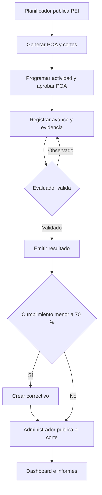

# Reglas operativas de SISPLAN

**Base de trabajo v1.0 · 12 de noviembre de 2026.** Los requisitos y los identificadores se conservan en la [matriz de trazabilidad](05-TRAZABILIDAD.md). Este documento fija las decisiones del diseño del equipo donde el SRS deja alternativas o vacíos. Si el maestro da una aclaración distinta, actualizar la regla, el contrato y su prueba en el mismo cambio.

## Institución, alcance y permisos

La primera versión administra **una institución con varias dependencias**. Una cuenta puede tener varios roles y asignaciones. La API exige un permiso explícito por acción y verifica el alcance de la dependencia del registro, incluidas consultas, evidencias y exportaciones. El identificador de usuario es el par emisor y sujeto del proveedor de identidad. Una cuenta desactivada o sin asignación recibe acceso denegado aunque conserve una sesión del proveedor.

| Rol | Puede hacer | Alcance |
|---|---|---|
| Administrador | Administrar catálogos, unidades, usuarios y asignaciones. Configurar indicadores. Publicar evaluaciones emitidas. Consultar auditoría | Institucional |
| Planificador | Formular, revisar, aprobar y publicar PEI. Crear y aprobar productos, aprobar versiones de POA, consolidar resultados y elaborar informes. Autorizar incorporación de trabajo adicional | Institucional. La aprobación de una versión exige un planificador distinto de quien la envió |
| Responsable de Área | Formular actividades y programación, registrar avances, indicadores y evidencias, presentar correctivos y solicitudes de trabajo adicional | Dependencias asignadas |
| Evaluador | Revisar evidencias, observar o validar avances, emitir resultados y verificar correctivos | Dependencias asignadas. Una cuenta no valida un avance que ella registró |
| Consultor | Consultar planes y resultados publicados y descargar reportes de su alcance | Dependencias asignadas o ámbito institucional asignado |
| Consulta Ejecutiva | Consultar dashboard de resultados publicados | Ámbito institucional asignado. El detalle conserva las restricciones de acceso |

Las asignaciones de la aplicación se gestionan desde SISPLAN. La cuenta de identidad se crea en Keycloak por el operador designado. Las cuentas de demo representan los seis roles y dos planificadores distintos. Los roles del sistema son independientes de los cinco frentes de desarrollo.

## PEI, POA y versiones

| Decisión | Comportamiento |
|---|---|
| Período | Fechas inclusivas `YYYY-MM-DD` y zona `America/Santo_Domingo`. El período se deriva del año de inicio al de fin. Ordinario = cuatro años calendario inclusivos, extraordinario = cinco. Se admiten años parciales y se conserva la fecha exacta. |
| Estados del PEI | `borrador → en_revision → aprobado → publicado`. Revisar puede devolver a `borrador` con motivo. La persona que aprueba es distinta de quien envía. Publicar requiere aprobación y ejes, objetivos e indicadores vinculados. |
| Vigencia | Un PEI publicado es vigente en las fechas que cubre. Dos PEI distintos de la institución no pueden tener intervalos publicados solapados. El histórico se consulta por fecha y versión. |
| Generación | La primera publicación crea, en una transacción, un POA por año cubierto y tres evaluaciones por POA. Unicidad por PEI/año y POA/cuatrimestre. Repetir el evento recupera los mismos registros. |
| Años futuros y parciales | Se pueden formular POA futuros bajo un PEI publicado para ese año. Un avance requiere actividad, versión aprobada y fecha de ejecución dentro de la vigencia del PEI y del año POA. Un corte sin días de vigencia queda identificado como fuera de vigencia. Los tres cortes conservan sus meses oficiales. |
| POA y productos | El POA sigue `formulacion → en_revision → aprobado → en_ejecucion → cerrado`. Entra en ejecución en su intervalo vigente. El planificador lo cierra al finalizar su intervalo con los tres cortes publicados o marcados fuera de vigencia. Los productos se envían y se aprueban individualmente. El planificador aprueba una versión de POA con productos aprobados y programa su entrada en vigor. El producto exige descripción, unidad de medida y responsable asignado (RF-007). La actividad exige responsable, fechas y vínculo al producto. El producto referencia un indicador de la versión estratégica correspondiente, del que se derivan eje y objetivo. |
| Cambios | Una entidad aprobada se conserva. Para corregirla se crea otra revisión con motivo y referencia a la anterior. Las revisiones de programación y presupuesto son prospectivas y se aplican después del último corte publicado. Las correcciones de un corte histórico conservan ese corte y generan una revisión identificable. Una revisión del mismo PEI conserva sus fechas de vigencia. Las versiones de POA y cortes históricos conservan su referencia al PEI y siguen consultables. Los ejes se inactivan en la nueva versión. |
| Concurrencia | Una escritura sobre un registro existente exige `If-Match` de su último `ETag`. Ausencia `428`, versión obsoleta `412`, estado incompatible `409`, campo inválido `422`. La actualización y su auditoría se confirman juntas. |

El POA permite registrar y consultar la **meta anual, la programación mensual y la programación cuatrimestral** (RF-009). Cada meta conserva período, unidad, versión y nivel. La meta anual y los tres cuatrimestres se pueden capturar como metas de referencia. Cuando el método lo permite, la aplicación propone valores derivados de los meses. Para aprobar una programación aditiva se concilian los valores de los tres niveles. Para una razón o último valor se aplica el método del indicador, sin sumar porcentajes o saldos.

La meta y el medio de verificación se guardan en el producto aun si no tiene actividades detalladas. Las actividades pueden tener metas, presupuesto y medios propios o un desglose vinculado a su producto. Los totales de producto y su desglose no se cuentan dos veces. El indicador de la actividad se puede rastrear por su vínculo al producto y al PEI. El mapa estratégico permite recorrer ejes y objetivos, con sus indicadores, resultados y líneas de acción. Cada meta plurianual queda vinculada al indicador y al año del PEI que le corresponde. El medio esperado se registra como parte del plan. La evidencia efectiva es el documento o enlace adjunto a una ejecución.

El Excel de TI muestra doce meses agrupados en cuatro trimestres. En SISPLAN las evaluaciones siempre usan enero–abril, mayo–agosto y septiembre–diciembre. En la captura se distingue **sin dato** (`null`) de **no programado confirmado** (cero explícito). Para obtener una suma preliminar se usan los valores disponibles y se marca la cobertura incompleta. Antes de aprobar el total de un tramo, el responsable confirma los meses aplicables o registra explícitamente cuáles no se programan.

## Avances, evaluación y publicación

1. El responsable registra un avance por actividad y mes, con cantidades físicas, gasto del mes, comentario y evidencia. Una revisión del avance sustituye la revisión anterior para los cálculos del mes. Cada cantidad representa el incremento de ese mes, salvo mediciones de tipo último valor o razón, que siguen el catálogo.
2. El evaluador observa o valida la revisión vigente. Una devolución exige motivo y permite corregir y reenviar. El planificador verifica la consolidación de su ámbito con las revisiones validadas.
3. Los estados de una evaluación son `generada → en_revision → emitida → publicada`. Para emitir, el evaluador debe verificar evidencia de cada resultado evaluado, revisar y confirmar su calificación y congelar las versiones de programación, avances y evidencias utilizadas. Las métricas pendientes se muestran con su causa. La calificación usa el cálculo y semáforo del sistema. El evaluador registra observaciones y corrige datos de origen antes de recalcular. Si el corte vigente carece de una base calculable, el evaluador puede emitirlo con evidencia y justificación, dejando los resultados como «Sin base de cálculo» o «Pendiente» según corresponda. Los tres cortes se generan siempre. Un corte sin días de vigencia se identifica por fechas y conserva su registro. El tratamiento administrativo de ese corte requiere confirmación del maestro.
4. La emisión de un resultado rojo crea su plan correctivo obligatorio en la misma transacción. Se asigna al responsable del área y el evaluador verifica su cierre. El correctivo tiene causa, acción, responsable, fecha límite, evidencia y estado `pendiente → en_ejecucion → en_revision → cerrado`. La publicación muestra los correctivos pendientes. No exige que ya estén ejecutados.
5. El administrador publica un resultado emitido. El dashboard obtiene PEI y POA vigentes desde su programación aprobada, aunque todavía no haya una evaluación publicada. Los informes PEI y POA pueden mostrar esa planificación. Las cifras de ejecución y cumplimiento oficiales provienen de cortes publicados, con su versión y estado visibles. Una corrección posterior emite una nueva revisión con motivo y vínculo al corte original. El historial conserva qué versión alimentó cada reporte.

## Cálculo, consolidación y presupuesto

| Tema | Regla para implementar y probar |
|---|---|
| Base válida | Con programado positivo y ejecución validada, el cumplimiento es `ejecutado / programado × 100`. Programado cero o ausente se presenta como «Sin base de cálculo». Sin ejecución validada se muestra «Pendiente». Si se registra y valida ejecución cero con meta positiva, el resultado es 0 %. |
| Avance y sobreejecución | El avance porcentual se limita a 100 % y la API rechaza un avance declarado superior. La cantidad real y el cumplimiento calculado se conservan completos. Si se muestra un avance calculado a partir del cumplimiento, se aplica `min(100, cumplimiento)`. Así, 12 de 10 da 100 % de avance calculado y 120 % de cumplimiento. |
| Semáforo | Rojo menor a 70 %. Amarillo desde 70 % hasta menos de 90 %. Verde desde 90 %. Clasificar con valores completos. Mostrar hasta dos decimales truncados para evitar que un redondeo aparente cruzar el umbral. «Sin base» y «Pendiente» tienen etiquetas propias. |
| Métodos de medición | `suma` para cantidades acumulables, `ultimo` para niveles al cierre y `razon` para tasas. La razón almacena numerador y denominador, los consolida por separado y divide solo con denominador positivo. La fórmula explicativa del catálogo es texto. El cálculo lo ejecutan esos métodos definidos en la API. |
| Consolidación | Calcular primero cada indicador con mediciones comparables, unidad y corte coherentes. Agrupar para cada vista por eje, objetivo, área e institución. Cada indicador aporta una sola puntuación por grupo. Media simple de puntuaciones válidas con máximo 100 por aporte, acompañada de válidos/esperados. Si falta un resultado esperado, indicar cobertura parcial. Separar métricas esperadas, evaluadas, sin base y pendientes. Si ninguna tiene puntuación válida y alguna conserva meta positiva sin validación, el agregado queda «Pendiente». Si ninguna tiene una meta utilizable, queda «Sin base de cálculo». |
| Vínculos estratégicos | El responsable registra la medición del indicador por período y ámbito autorizado. El evaluador valida su revisión con evidencia. La medición se conserva con unidad, método, frecuencia, meta y versión, y se auditan sus cambios. El cumplimiento de un producto no sustituye automáticamente la medición del indicador. Ejemplo: jornadas realizadas y porcentaje de personal capacitado son medidas distintas. |
| Presupuesto | DOP, montos decimales con dos posiciones. Separar estimado, autorizado y ejecutado. Solo se suman importes de la misma moneda, período y alcance. Ejecución presupuestaria = gasto validado / monto autorizado × 100, con las mismas reglas de base válida. El exceso se muestra como desviación. En la plantilla del reto, el presupuesto se asocia a solicitudes de insumos y la columna U excluye RR. HH., flota adherida al puesto y aumentos salariales. |
| Reportes | PEI, POA, cuatrimestral, anual, indicadores y presupuesto. PDF y XLSX utilizan la misma consulta autorizada, con versión y corte visibles. Las cifras agregadas deben cuadrar con el dashboard al aplicar los mismos filtros. |

Para avance, metas y cantidades usar decimales; las cantidades admiten hasta cuatro posiciones. El cálculo de referencia de la demo usa una meta de tres y ejecución de dos, con evidencia validada. El resultado es **66,66 % mostrado, rojo y con correctivo**. El plan muestra los casos límite de 70 %, 90 %, base cero y sobreejecución.

| Caso mínimo | Resultado esperado |
|---|---|
| Meta 10, ejecutado validado 0 | 0 %, rojo y correctivo |
| Meta 10, ejecutado 7 | 70 %, amarillo |
| Meta 10, ejecutado 8,9999 | 89,99 % mostrado, amarillo |
| Meta 10, ejecutado 9 | 90 %, verde |
| Meta 10, ejecutado 12 | 120 % de cumplimiento, 100 % de avance |
| Meta cero o vacía | Sin base de cálculo, sin semáforo ni correctivo automático |
| Meta positiva y avance sin validar | Pendiente, se informa como faltante en la cobertura |

### Indicadores clave del SRS

Además de mostrar PEI y POA vigentes y cumplimiento institucional y por área, el dashboard y sus vistas de detalle cubren los ocho indicadores de §9. Las fórmulas de agregación siguientes son decisiones de la base, pues el SRS enumera los indicadores y no especifica todos sus denominadores.

| Indicador | Evidencia que debe mostrar el resultado |
|---|---|
| % cumplimiento PEI | Consolidación de indicadores estratégicos de ese PEI, con versión, corte y cobertura |
| % cumplimiento por eje | Consolidación de indicadores del eje dentro del PEI seleccionado |
| % cumplimiento por objetivo | Consolidación de indicadores vinculados al objetivo seleccionado |
| % cumplimiento por indicador | Resultado del indicador con meta, ejecución, unidad y frecuencia compatibles |
| % cumplimiento POA | Media de cumplimiento de productos con base válida en el POA y corte, con aporte máximo de 100 por producto y cobertura |
| % ejecución presupuestaria | Gasto validado dividido por presupuesto autorizado, en la misma moneda y alcance |
| % actividades completadas | Actividades del corte con conclusión validada divididas por actividades programadas aplicables |
| % productos entregados | Productos del corte con entrega validada divididos por productos programados para entrega en ese corte |

En los dos indicadores de conteo, completar una actividad o entregar un producto se confirma con evidencia de resultado. Aprobación de la programación y validación de la ejecución son eventos distintos. Si no existen elementos aplicables, se presenta «Sin base de cálculo».

## Trabajo no planificado, proyectos, riesgos y alertas

- **Trabajo no planificado.** El responsable registra motivo, área, responsable, fechas y estimación. El planificador decide la autorización del trabajo en `solicitada → autorizada` o `devuelta/rechazada`. La ejecución sigue `no iniciada → registrada → validada` o `observada`, y se puede corregir y reenviar. Para hechos que ya ocurrieron se registra la fecha real y se mantiene la indicación «Sin autorización previa». El evaluador valida ejecución y evidencia. El planificador decide si incorpora el trabajo en una nueva revisión del POA. Un cambio de monto requiere la capacidad específica de autorización presupuestaria asignada al planificador y deja motivo y diferencias. La revisión tiene efecto prospectivo. Las ejecuciones anteriores conservan su propio corte y se muestran como trabajo adicional en el histórico. Un avance conserva su identificador y se contabiliza una vez, aunque se vincule a una actividad incorporada.
- **Proyectos.** Portafolio contiene programas y programa contiene proyectos. Cada proyecto se vincula a un objetivo, tiene responsable, fechas, hitos y entregables. Puede vincular actividades existentes del POA. Las cifras financieras se consultan desde esas actividades para evitar duplicación. El planificador gestiona el catálogo y el responsable asignado informa su avance.
- **Riesgos.** Un riesgo estratégico se vincula a un objetivo y uno operativo a una actividad o proyecto. Probabilidad e impacto van de 1 a 5. Su producto clasifica bajo 1–4, medio 5–14 y alto 15–25. El responsable registra tratamiento, acción, fecha y evidencia. Riesgos altos requieren mitigación antes de cerrar el riesgo. El planificador valida el tratamiento.
- **Alertas.** Bandeja interna. Actividad vencida para el responsable de área, evaluación pendiente para el evaluador asignado, indicador desactualizado para su responsable e incumplimiento para el responsable de área y planificador. Una actividad activa vence al día siguiente de su fecha fin. La evaluación queda pendiente al finalizar el cuatrimestre si el corte contiene días vigentes y sigue sin publicar. El indicador queda desactualizado si termina su período de frecuencia sin medición validada. El resultado rojo avisa al emitirse. Un proceso comprueba vencimientos cada 15 minutos y al arrancar. Un evento por tipo, registro, corte y destinatario mientras siga la condición. Una alerta cerrada por resolución queda en historial.
- **Auditoría.** Registrar actor, instante UTC, entidad, acción, valores anterior y nuevo y motivo cuando aplica. El registro se genera en servidor en la transacción de la acción y tiene consulta restringida. Las evidencias y revisiones aprobadas conservan su referencia y archivo histórico.

[Especificación del maestro, Excel y consigna](https://sisplan-reto-web-equipo.bzps4s5pp8.chatgpt.site/#documentos)
